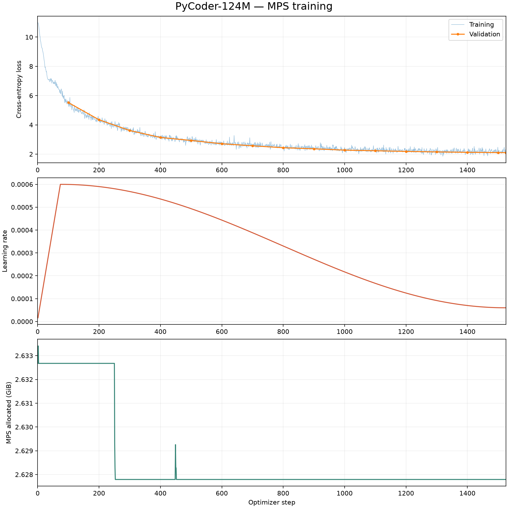

# PyCoder-124M: MPS training run

The run finished on October 31, 2026, at step 1,526 of 1,526. Training was
resumed across multiple sessions; the chart retains the most recent session's
values where steps overlap. The first recorded training step was on October 30
at 22:51 and the final step on October 31 at 11:42 local time. This elapsed
interval includes interruptions and does not represent uninterrupted training.

## Configuration and results

- Model: `configs/model_124m.yaml`, 123,587,328 parameters; context 1,024.
- Training: `configs/train_124m.yaml`, float32 on Apple MPS, batch 4,
  gradient accumulation 16, 65,536 tokens per optimizer step.
- Training data: 94,508,944 tokens; validation data: 5,017,757 tokens.
- Dataset: `Avelina/python-edu-cleaned`, revision
  `3fedf55e02e72dd1fd68963f991f5e91adcb0f8d`, sampled from the first shard.
- Last recorded training loss: 2.1377; final logged validation loss: 2.1020
  on 20 batches of 4 sequences.
- Separate final evaluation: loss 2.1244 and perplexity 8.37 on the first
  100 batches of 4 sequences. This is a subset of the validation stream.
- The MPS memory chart shows PyTorch allocated memory at logging time, not peak
  memory or total unified memory consumption.

The dataset stream cycles when exhausted; the 100 million tokens processed are
not all distinct. Exact duplicates were filtered, but approximate duplicates,
benchmark contamination and per-file licenses were not fully reviewed.
Validation loss measures next-token prediction, not functional correctness.
One sampled Fibonacci completion produced invalid Python; systematic functional
evaluation remains to be done. The generated checkpoint, tokenizer, dataset and
raw TensorBoard event files are local artifacts and are not tracked in Git.
